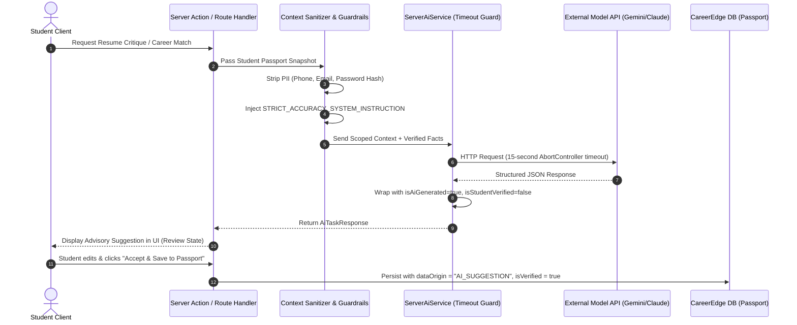

# Aeterna CareerEdge — AI Integration Architecture & Guardrails

## 1. Architectural Principles

CareerEdge employs Artificial Intelligence strictly as an **advisory intelligence engine** to augment student decision-making, not as a maker of factual claims.

### The Immutable AI Laws:
1. **Server-Side Only:** AI provider calls occur exclusively in server-side routes and actions (`src/lib/ai/`). Model API keys are **never** bundled or exposed to the client browser.
2. **Never Treat AI Output as Verified Fact:** Every recommendation, resume critique, or career match generated by an AI model is explicitly tagged with `isAiGenerated: true` and `isStudentVerified: false`.
3. **Student In The Loop:** Suggestions must be presented for student review, modification, and confirmation before persisting into the Career Passport.
4. **Context Minimization:** Only send the student details strictly necessary for the specific prompt. Redact direct PII (phone number, email, password hash, IP).

---

## 2. Hallucination Prevention & Factual Guardrails

Language models frequently hallucinate specific numbers, dates, and prerequisites. The CareerEdge engine strictly prohibits inventing facts across 10 critical domains:

| Domain | Prohibited Action | Required Enforcement |
|---|---|---|
| **1. Grades & CGPA** | Never invent marks, percentages, or GPA. | Use only grades declared in `education_records`. |
| **2. Work Experience** | Never invent employment duration, roles, or employers. | Anchor strictly on `student_experiences`. |
| **3. Skills** | Never assert a student possesses a skill they did not declare. | Highlight missing skills as *gaps to learn*, not existing competencies. |
| **4. University Fees** | Never guess or hallucinate tuition fees. | Pull strictly from `reference_courses` or cite official university prospectus URL. |
| **5. Admission Cutoffs** | Never make up entrance cutoff ranks or minimum percentages. | Cite official KEA / COMEDK cutoff tables with year. |
| **6. Job Openings** | Never invent active recruiter job openings. | Link exclusively to verified `reference_job_listings`. |
| **7. Salaries** | Never state speculative compensation as guaranteed. | Present salary bands only when officially disclosed by the employer. |
| **8. Visa Regulations** | Never invent work permit durations or post-study visa rights. | Quote statutory rules from official immigration services (USCIS, UKVI). |
| **9. Scholarship Deadlines** | Never fabricate application closing dates. | Rely only on active `reference_scholarships` with verified deadline dates. |
| **10. Counsellor Availability**| Never promise specific counsellor availability without live calendar sync. | Show requests as `PENDING_CONFIRMATION` until scheduled. |

---

## 3. Server-Side Provider Abstraction

CareerEdge isolates model provider SDKs behind a unified interface:

```typescript
// src/lib/ai/provider.ts
export interface AiProvider {
  name: string;
  generateStructuredAdvice<T>(
    request: AiTaskRequest,
    expectedSchemaDescription: string
  ): Promise<AiTaskResponse<T>>;
}
```

### Execution Flow & Safeguards



---

## 4. Standard System Prompt Invariant

Every call to an LLM provider injects the standard CareerEdge accuracy preamble:

```text
You are the CareerEdge Intelligence Engine, designed for students in Karnataka and India.

MANDATORY FACTUAL ACCURACY RULES:
1. NEVER invent student qualifications: Do NOT make up grades, GPAs, project details, or prior work experience not provided in the input context.
2. NEVER invent institutional facts: Do NOT invent university tuition fees, admission cutoffs, visa quotas, scholarship deadlines, or counsellor availability.
3. GROUNDING: Base all suggestions strictly upon the verified reference context and student details provided.
4. HONESTY: If factual data is missing or unverified, explicitly state that it requires verification from the official university or government source.
5. LABELING: Every output generated is an advisory suggestion and must be reviewed and confirmed by the student before being added to their Career Passport.
```

---

## 5. Fallback & Resilience Strategy

- **Timeout Handling:** Every external request is wrapped in an `AbortController` configured with a 15,000ms timeout.
- **Graceful Fallback:** If API credentials (`GEMINI_API_KEY`) are missing in development, the engine automatically falls back to a deterministic mock advisory response rather than crashing or throwing unhandled errors.
- **Rate Limit Resilience:** Backoff retry with jitter on HTTP 429 status codes.
