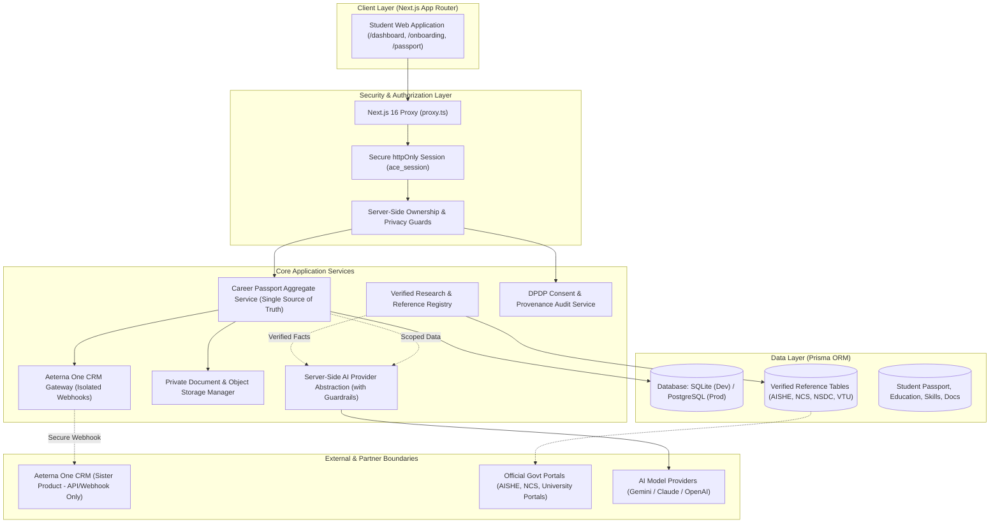

# Aeterna CareerEdge — System Architecture Specification

## 1. Architectural Philosophy

Aeterna CareerEdge is designed as an AI-powered, ethical, and verifiable career and employability platform tailored for college students across Karnataka and India. 

The core architectural invariant is:
> **The Student Career Passport is the Single Source of Truth.**
> Every student-facing feature (Resume Builder, SOP Builder, LinkedIn Optimizer, Career Discovery, Job Matcher, and Mentorship) reads from and writes to the student's central Career Passport. The platform must never ask a student to re-enter information already present in their Passport.

---

## 2. High-Level Architecture Diagram

---

## 3. Four-Tier Data Origin Framework

Aeterna CareerEdge strictly enforces the distinction between four tiers of information:

| Data Origin Tier | Definition | Verification Status | Usage Rules |
|---|---|---|---|
| **1. Student-Provided** (`STUDENT_INPUT`) | Entered manually by the student during onboarding or profile editing. | Assumed self-declared; unverified until supported by transcripts. | Editable by student at any time. |
| **2. Document-Extracted** (`DOCUMENT_EXTRACTED`) | Parsed via OCR or document parsing from uploaded marksheets/resumes. | Draft / Pending student confirmation. | Must be previewed and confirmed by the student before persisting to the Passport. |
| **3. Verified Reference** (`VERIFIED_REFERENCE`) | Facts from official sources (AISHE codes, VTU course syllabi, NCS occupational standards). | Formally verified with provenance tracking. | Gold-standard benchmark for matching, grading, and validations. |
| **4. AI-Generated Suggestions** (`AI_SUGGESTION`) | Generated by server-side AI engines (e.g. resume bullet improvements, career match ideas). | **NEVER verified student facts.** Marked `isAiGenerated: true`. | Advisory only. Must be explicitly accepted or edited by student before becoming part of their profile. |

---

## 4. Subsystem Breakdown

### 4.1. Single Source of Truth: Career Passport
- **Service:** `src/lib/passport/service.ts`
- **Responsibilities:**
  - Encapsulates student data retrieval across education records, skills, projects, and work experience.
  - Generates the unified `StudentPassportSnapshot`.
  - Ensures down-stream tools (Resume Builder, SOP Builder) pull profile data automatically.

### 4.2. Research & Reference Data Subsystem
- **Modules:** `src/lib/research/provenance.ts`, `src/lib/research/registry.ts`
- **Data Governance:**
  - Facts regarding university tuition, admission cutoffs, visa rules, and occupational codes are **never generated from AI model knowledge alone**.
  - All reference facts are stored in dedicated tables with mandatory provenance fields (`sourceName`, `sourceUrl`, `retrievedDate`, `lastVerifiedDate`, `verificationStatus`, `country`).
  - Stale data guard: Data older than 180 days is flagged for re-verification.

### 4.3. Server-Side AI Architecture
- **Modules:** `src/lib/ai/provider.ts`, `src/lib/ai/guardrails.ts`, `src/lib/ai/types.ts`
- **Responsibilities:**
  - Standard provider abstraction (`AiProvider`) insulating the app from specific vendor APIs.
  - Server-side execution only; API keys are never exposed in browser bundles.
  - Context minimization: PII (phone, email, password hashes) is stripped before prompt assembly.
  - Grounding: System prompts strictly mandate zero hallucination of student achievements, fees, or deadlines.
  - Structured tagging: All outputs are wrapped with `isAiGenerated: true` and `isStudentVerified: false`.

### 4.4. Private Document & Object Storage
- **Module:** `src/lib/storage/private-storage.ts`
- **Responsibilities:**
  - Private storage keys (`private/students/{userId}/{timestamp}-{salt}.ext`) prevent directory enumeration.
  - No public bucket URLs. Files are accessed only after server-side ownership checks (`authorizeDocumentAccess`).
  - Strict isolation: Student A cannot download or view Student B's documents under any circumstances.

### 4.5. Sister Product Integration: Aeterna One CRM
- **Module:** `src/lib/crm/aeterna-one.ts`
- **Responsibilities:**
  - Aeterna One is a distinct sister platform. **Direct database connections to Aeterna One are strictly prohibited.**
  - Communication occurs exclusively through authenticated HTTPS webhooks or documented REST APIs.
  - When credentials are not yet supplied, leads are staged locally in CareerEdge (`CrmLead` table) with status `PENDING`.
  - Never simulates or fakes a successful handover to the CRM.

### 4.6. Security, Compliance & DPDP Foundations
- **Module:** `src/lib/compliance/consent.ts`
- **Digital Personal Data Protection (DPDP) Act 2023 Readiness:**
  - Consent tracking (`ConsentRecord`) records timestamp, IP, user-agent, and version.
  - Independent optional consent for counsellor contact.
  - Foundation for **Right to Data Portability** (`exportStudentData`).
  - Foundation for **Right to Erasure** (`deleteStudentAccount`).
