# Aeterna CareerEdge — Database Schema Specification

## 1. Overview & Strategy

The CareerEdge database is designed using **Prisma ORM**.
- **Development Environment:** SQLite (`file:./dev.db`) for zero-credential local setup and testing.
- **Production Environment:** PostgreSQL (via Supabase, Neon, AWS RDS, or Railway). The schema is 100% PostgreSQL-compatible; transition requires only updating the `provider` and `DATABASE_URL`.

All student data is anchored around the **User** identity and aggregated into the **Student Career Passport**.

---

## 2. Entity-Relationship Diagram

```mermaid
erDiagram
    users ||--o| student_profiles : "has central passport"
    users ||--o{ education_records : "attends"
    users ||--o{ student_skills : "possesses"
    users ||--o{ student_projects : "builds"
    users ||--o{ student_experiences : "works at"
    users ||--o{ certifications : "holds"
    users ||--o{ resumes : "generates"
    users ||--o{ sop_documents : "drafts"
    users ||--o| linkedin_profiles : "optimizes"
    users ||--o{ career_assessments : "completes"
    users ||--o{ career_recommendations : "receives"
    users ||--o{ job_applications : "submits"
    users ||--o{ counselling_requests : "requests"
    users ||--o{ consent_records : "grants/revokes"
    users ||--o{ stored_documents : "uploads"
    users ||--o{ crm_leads : "generates"

    career_assessments ||--o{ career_recommendations : "informs"
    crm_leads ||--o{ crm_sync_logs : "records attempts"

    data_sources ||--o{ reference_institutions : "verifies"
    data_sources ||--o{ reference_courses : "verifies"
    data_sources ||--o{ reference_occupations : "verifies"
    data_sources ||--o{ reference_skills : "verifies"
    data_sources ||--o{ reference_job_listings : "verifies"
    data_sources ||--o{ reference_study_destinations : "verifies"
    data_sources ||--o{ reference_admission_requirements : "verifies"
    data_sources ||--o{ reference_scholarships : "verifies"

    reference_institutions ||--o{ reference_courses : "offers"
    reference_institutions ||--o{ reference_admission_requirements : "stipulates"
    reference_courses ||--o{ reference_admission_requirements : "applies to"
```

---

## 3. Data Dictionary

### 3.1. Identity, Passport & Consents

#### `users`
Core authentication and authorization entity.
- `id` (String, PK, CUID): Unique user identifier.
- `name` (String): Full student name.
- `email` (String, Unique): Verified email address.
- `mobile` (String, Unique, Nullable): 10-digit Indian mobile number (+91).
- `passwordHash` (String, Nullable): Bcrypt hash (cost 12); null for OAuth-only users.
- `counsellorConsent` (Boolean, default false): Separate optional permission for counsellor outreach.
- `onboardingCompleted` (Boolean, default false): Controls route interception to `/onboarding`.
- `createdAt`, `updatedAt` (DateTime).

#### `student_profiles`
The aggregated single source of truth (Universal Career Passport).
- `id` (String, PK, CUID).
- `userId` (String, Unique, FK $\rightarrow$ `users.id`, Cascade Delete).
- `city`, `state`, `country` (String): Geographical location.
- `headline`, `bio` (String, Nullable): Student professional summary.
- `academicDomain` (String, Nullable): One of 17 academic/professional domains (e.g. Commerce, Law, Healthcare, Engineering).
- `specialization` (String, Nullable): Domain focus (e.g. "Taxation & Audit", "Constitutional Law", "Clinical Nursing").
- `educationLevel`, `institution`, `course`, `graduationYear` (Summary indicators).
- `gradingType`, `gradeValue` (String, Nullable): E.g., "CGPA (10-point Scale)", "8.85 CGPA".
- `skills`, `projects`, `experience`, `achievements`, `certifications` (Serialized JSON summaries).
- `careerInterests`, `preferredJobRole`, `targetIndustry` (Career alignment indicators).
- `higherEducationGoal`, `shortTermGoal`, `longTermGoal`, `studyAbroadCountries` (Aspirations).
- `passportScore` (Int, default 15): Completeness calculation (0–100%).
- `isProfileLocked` (Boolean, default false): Lock state during official university placement drives.

#### `consent_records`
Auditable log of consents under India's Digital Personal Data Protection (DPDP) Act.
- `id` (String, PK, CUID).
- `userId` (String, FK $\rightarrow$ `users.id`, Cascade Delete).
- `consentType` (String): `TERMS_AND_PRIVACY` | `COUNSELLOR_CONTACT` | `RECRUITER_DATA_SHARING` | `AI_PROCESSING`.
- `isGranted` (Boolean, default true).
- `grantedAt` (DateTime, default now).
- `revokedAt` (DateTime, Nullable).
- `ipAddress`, `userAgent` (String, Nullable): Forensic audit info.
- `version` (String, default "1.0"): Version of terms consented to.

---

### 3.2. Normalized Student Profile Entities

Every normalized record carries:
- `dataOrigin`: `STUDENT_INPUT` | `DOCUMENT_EXTRACTED` | `VERIFIED_REFERENCE` | `AI_SUGGESTION`.
- `isVerified` (Boolean, default false).

#### `education_records`
Detailed academic timeline (10th, 12th/PUC, UG, PG).
- `id`, `userId` (FK $\rightarrow$ `users.id`, Cascade Delete).
- `level` (String): Qualification tier.
- `institution` (String): Name of school/college.
- `boardOrUniversity` (String, Nullable): E.g., VTU, Bangalore University, CBSE.
- `degree`, `fieldOfStudy` (String, Nullable): E.g., "B.E.", "Computer Science".
- `startYear`, `endYear` (Int, Nullable).
- `scoreOrGrade`, `scoreType` (String, Nullable): E.g., "8.75", "CGPA".
- `isCurrent` (Boolean).

#### `student_skills`
Normalized individual skills.
- `id`, `userId` (FK $\rightarrow$ `users.id`, Cascade Delete).
- `name` (String): E.g. "Python", "React", "Embedded Systems".
- `category` (String, Nullable): `TECHNICAL` | `SOFT` | `DOMAIN` | `TOOL`.
- `proficiencyLevel` (String, Nullable): `BEGINNER` | `INTERMEDIATE` | `ADVANCED` | `EXPERT`.
- `yearsOfExperience` (Float, Nullable).

#### `student_projects`
Projects, research papers, legal briefs, clinical audits, or creative portfolios built by the student.
- `id`, `userId` (FK $\rightarrow$ `users.id`, Cascade Delete).
- `title`, `description` (String).
- `role` (String, Nullable).
- `projectType` (String): `ACADEMIC` | `RESEARCH` | `PRACTICAL` | `CREATIVE` | `CASE_STUDY`.
- `toolsOrTechnologies` (String, Nullable): JSON array of tools/methods used.
- `techStack` (String, Nullable): Backward-compatible JSON array.
- `projectUrl`, `artifactUrl`, `repositoryUrl` (String, Nullable): Links to paper, portfolio, code repository, or Drive presentation.
- `startDate`, `endDate`, `isCurrent`.

#### `student_experiences`
Internships, articleships, clinical rotations, research assistantships, and employment history.
- `id`, `userId` (FK $\rightarrow$ `users.id`, Cascade Delete).
- `companyName`, `jobTitle` (String).
- `employmentType` (String): `INTERNSHIP` | `FULL_TIME` | `PART_TIME` | `FREELANCE`.
- `experienceType` (String): `INTERNSHIP` | `WORK_EXPERIENCE` | `RESEARCH` | `CLINICAL` | `ARTICLESHIP` | `FREELANCE`.
- `location`, `locationType` (`ON_SITE` | `REMOTE` | `HYBRID`).
- `startDate`, `endDate`, `isCurrent`, `description`, `skillsUsed` (JSON).

#### `certifications`
Verified credentials and professional licenses (CA Foundation, Bar Enrollment, BLS/CPR, AWS, etc.).
- `id`, `userId` (FK $\rightarrow$ `users.id`, Cascade Delete).
- `title`, `issuingOrganization` (String).
- `issueDate`, `expiryDate` (DateTime, Nullable).
- `credentialId`, `credentialUrl` (String, Nullable).

#### `student_achievements`
Academic honors, moot court rankings, hackathons, publications, scholarships, or leadership roles.
- `id`, `userId` (FK $\rightarrow$ `users.id`, Cascade Delete).
- `title`, `description` (String).
- `category` (String, Nullable): `ACADEMIC` | `COMPETITION` | `RESEARCH_PUBLICATION` | `LEADERSHIP` | `COMMUNITY` | `SPORTS`.
- `issuer`, `dateAwarded`, `awardUrl` (String/DateTime, Nullable).

#### `career_goals`
Student career aspirations, industry targets, and higher education intentions.
- `id`, `userId` (FK $\rightarrow$ `users.id`, Cascade Delete).
- `targetRole`, `targetIndustry` (String, Nullable).
- `preferredWorkType` (String, Nullable): `FULL_TIME` | `INTERNSHIP` | `HYBRID` | `REMOTE`.
- `higherEducationGoal`, `studyAbroadCountries` (String, Nullable).
- `shortTermGoal`, `longTermGoal` (String, Nullable).

---

### 3.3. Documents & Career Toolkit

#### `stored_documents`
Private object storage metadata. **Files are never public.**
- `id` (String, PK, CUID).
- `userId` (String, FK $\rightarrow$ `users.id`, Cascade Delete).
- `originalFileName`, `mimeType`, `fileSizeBytes` (Metadata).
- `storageKey` (String, Unique): Opaque key in private bucket/disk.
- `category` (String): `RESUME` | `TRANSCRIPT` | `CERTIFICATE` | `SOP` | `OTHER`.
- `isPrivate` (Boolean, default true).
- `storageEngine` (String): `LOCAL_PRIVATE` | `S3` | `R2`.

#### `resumes`
Structured resume documents created in the Resume Builder.
- `id`, `userId` (FK $\rightarrow$ `users.id`, Cascade Delete).
- `title`, `targetRole`, `templateId`.
- `structuredData` (String, JSON): Full resume document tree.
- `atsScore` (Int, Nullable): 0–100 benchmark score.
- `feedback` (String, JSON): Specific improvement tips.
- `isDefault` (Boolean).

#### `sop_documents`
Statement of Purpose drafts created in the SOP Builder.
- `id`, `userId` (FK $\rightarrow$ `users.id`, Cascade Delete).
- `title`, `targetUniversity`, `targetProgram`, `guidelinesPrompt`, `draftContent`, `wordCount`, `feedback` (JSON).

#### `linkedin_profiles`
LinkedIn audit recommendations.
- `id`, `userId` (Unique, FK $\rightarrow$ `users.id`, Cascade Delete).
- `profileUrl`, `headlineSuggestion`, `summarySuggestion`, `actionItems` (JSON), `optimizationScore`.

---

### 3.4. Assessments, Recommendations & CRM

#### `career_assessments` & `career_recommendations`
- `career_assessments`: Stores RIASEC / Aptitude results (`responsesJson`, `scoresJson`, `dominantTraits`).
- `career_recommendations`: Recommendations linked to assessments or profiles. Carries **`isAiGenerated: true`** and **`isStudentReviewed: false`** to guarantee AI output is never treated as verified fact.

#### `counselling_requests` & `crm_leads` (Aeterna One)
- `counselling_requests`: Booking requests for career or study-abroad counselling.
- `crm_leads`: Isolated lead staging for Aeterna One.
  - `syncStatus`: `PENDING` | `SYNCED` | `FAILED`.
  - `syncAttempts`, `lastSyncAttempt`, `externalCrmId`, `errorMessage`.
- `crm_sync_logs`: Forensic log of every webhook attempt sent to Aeterna One.

---

### 3.5. Research & Reference Repositories (Data Provenance)

Every reference table links to `data_sources` and includes:
- `sourceUrl` (String): Direct link to the official page.
- `retrievedDate` (DateTime).
- `lastVerifiedDate` (DateTime).
- `verificationStatus` (String): `VERIFIED` | `PENDING_REVIEW` | `DEPRECATED`.
- `validUntil` (DateTime, Nullable).

Tables:
- `data_sources`: Master registry of official publishers (AISHE, NCS, NSDC, VTU).
- `reference_institutions`: Colleges, universities, AISHE codes, NAAC/NIRF accreditation.
- `reference_courses`: Degrees, branches, duration, syllabus links.
- `reference_occupations`: NCS/NOS occupational taxonomy, competency standards.
- `reference_skills`: Standardized skills aligned to National Occupational Standards.
- `reference_job_listings`: Verified recruiter openings (with salary disclosure tags).
- `reference_study_destinations`: Countries, visa routes, work permit rules.
- `reference_admission_requirements`: Entrance exams (KCET, COMEDK, JEE), cutoffs.
- `reference_scholarships`: Central/State government & trust scholarships.
